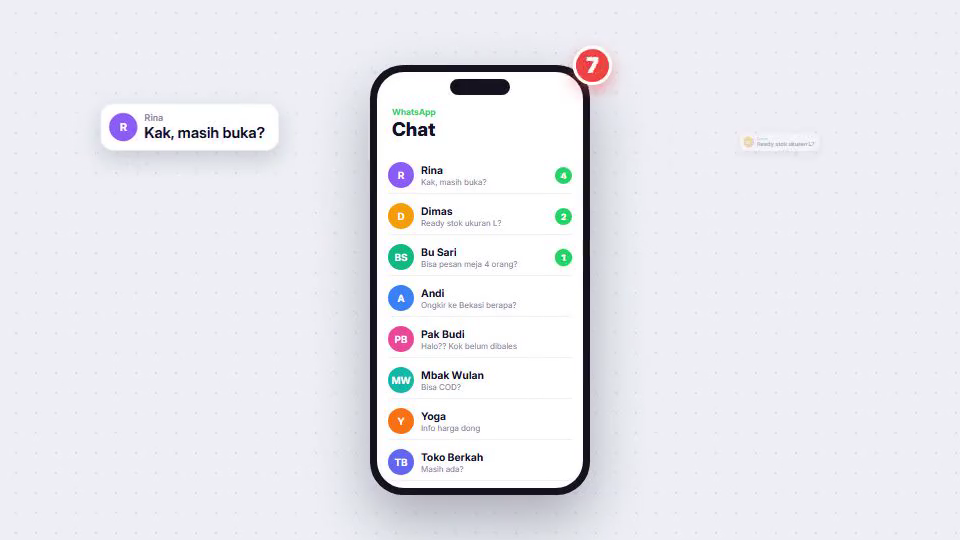
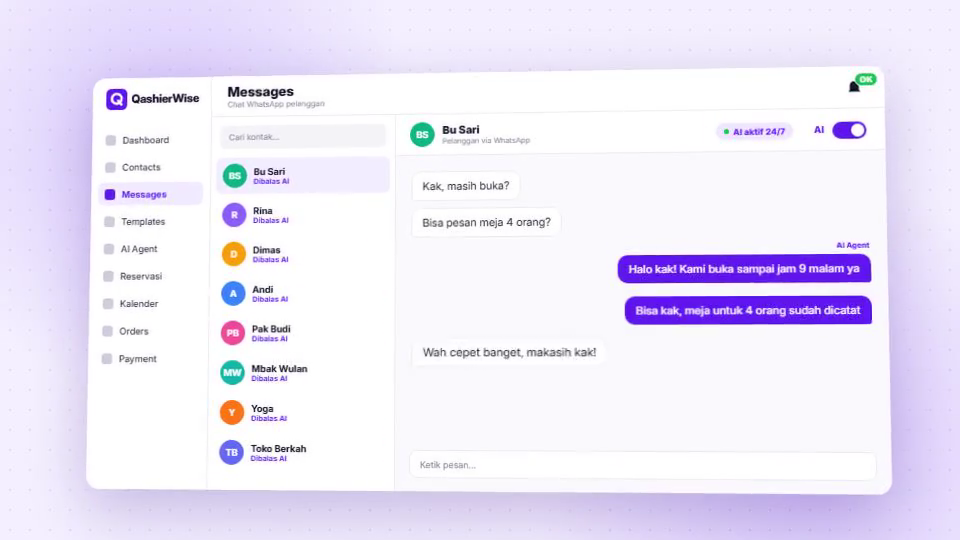
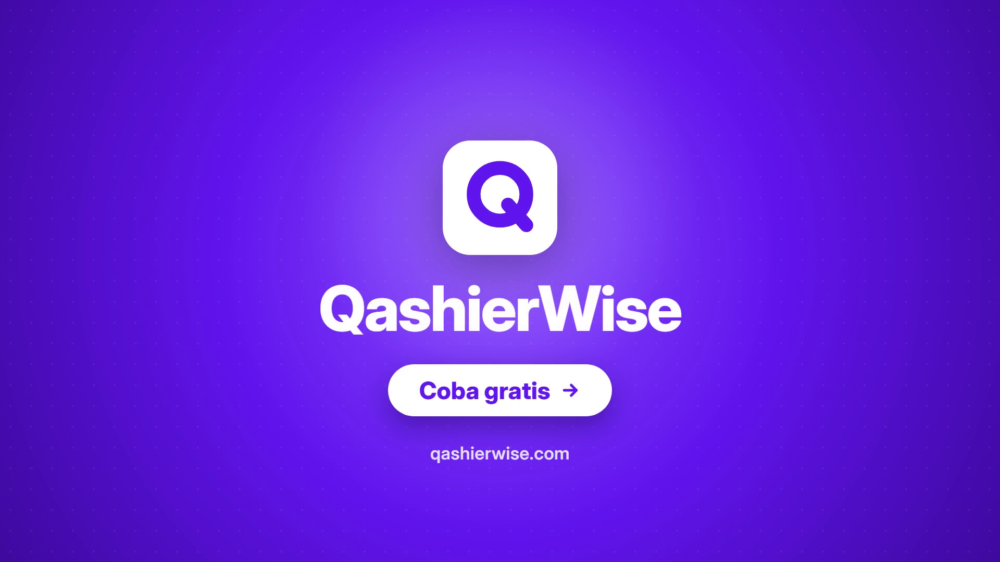
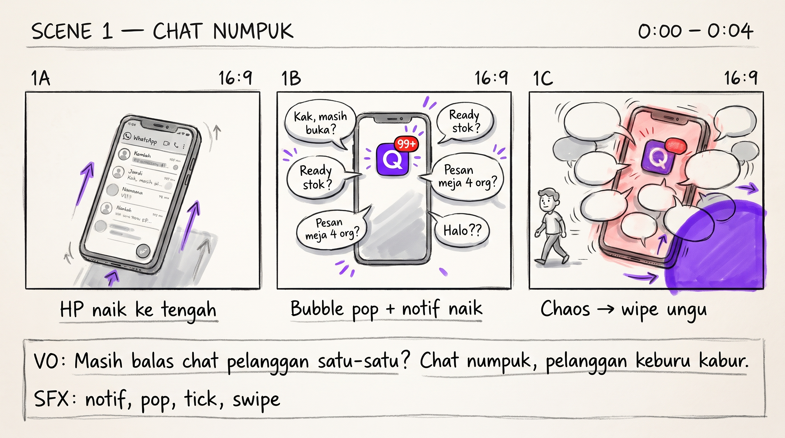
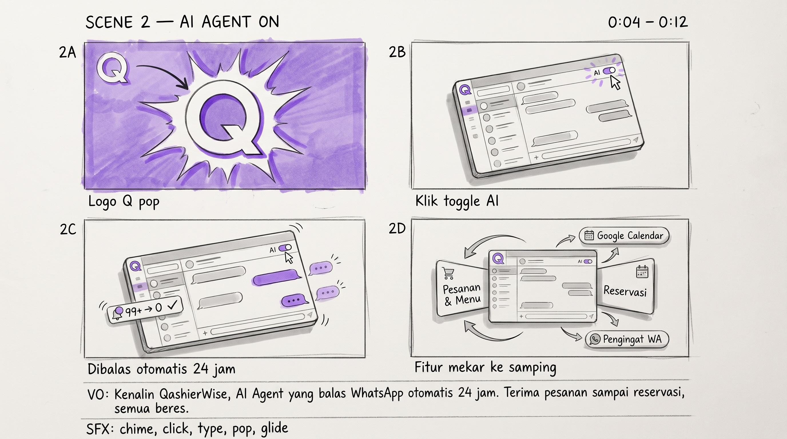
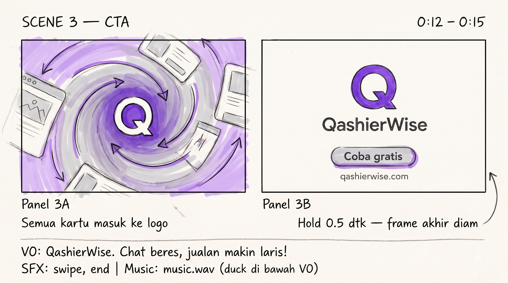
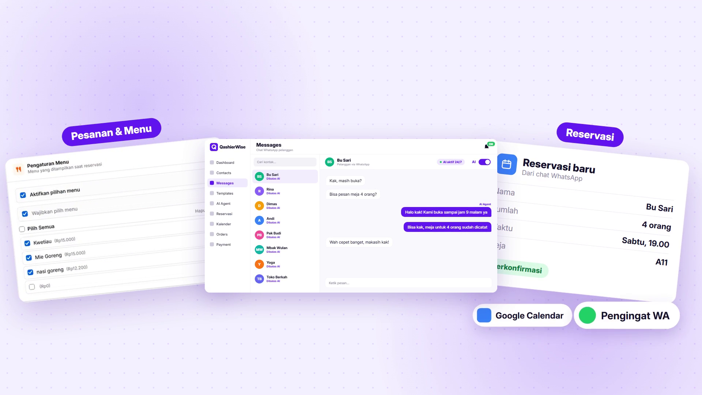
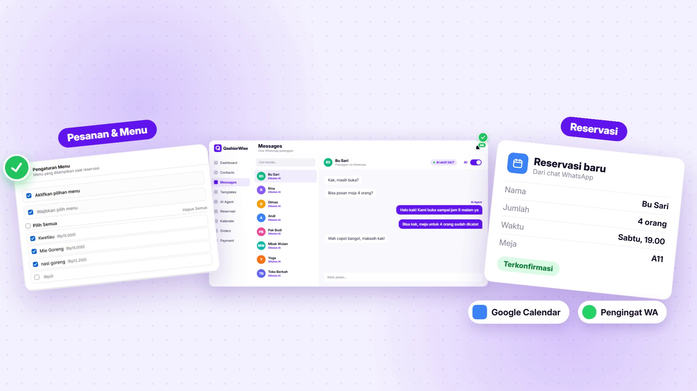

# QashierWise: Video Motion Graphics 15 Detik (dibuat bersama AI)

> **Tanggal:** 15 November 2026
> **Produk:** QashierWise, AI Agent yang membalas WhatsApp otomatis untuk UMKM
> **Hasil:** [`docs/output/qashierwise-15s.mp4`](docs/output/qashierwise-15s.mp4), 15.0 detik, 1920×1080, 30 fps, -14 LUFS
> **Asisten AI:** AdaL (agent AI untuk video, desain, dan coding)

**TL;DR:** Dokumen ini mencatat seluruh percakapan antara pengguna dan AI saat membuat video iklan motion graphics QashierWise. Isinya: semua prompt pengguna, jawaban AI, prompt yang dikirim AI ke model generatif (suara ElevenLabs, gambar storyboard), keputusan desain, masalah yang ditemukan saat review, dan cara memperbaikinya.

---

## Daftar isi

1. [Ringkasan hasil](#1-ringkasan-hasil)
2. [Bahan awal (folder assets)](#2-bahan-awal-folder-assets)
3. [Percakapan lengkap: prompt dan respons](#3-percakapan-lengkap-prompt-dan-respons)
   - [Turn 0: Permintaan storyboard](#turn-0-permintaan-storyboard)
   - [Turn 1: Konfirmasi brief](#turn-1-konfirmasi-brief)
   - [Turn 2: Minta storyboard gaya sketsa tangan](#turn-2-minta-storyboard-gaya-sketsa-tangan)
   - [Turn 3: Lanjut produksi](#turn-3-lanjut-produksi)
   - [Turn 4: Minta README ini](#turn-4-minta-readme-ini)
4. [Prompt yang dikirim AI ke model generatif](#4-prompt-yang-dikirim-ai-ke-model-generatif)
5. [Proses produksi langkah demi langkah](#5-proses-produksi-langkah-demi-langkah)
6. [Review, temuan, dan perbaikan](#6-review-temuan-dan-perbaikan)
7. [Struktur file](#7-struktur-file)
8. [Biaya dan lisensi](#8-biaya-dan-lisensi)
9. [Pelajaran dari proses ini](#9-pelajaran-dari-proses-ini)

---

## 1. Ringkasan hasil

| Waktu | Scene | Yang terlihat | Narasi (suara "Tyo Utama", ElevenLabs) |
|---|---|---|---|
| 0:00–0:04.3 | **1 · Chat Numpuk** | HP WhatsApp naik ke tengah, bubble chat pelanggan bermunculan, notif naik ke 99+, layar memerah dan bergetar, pelanggan pergi, lalu lingkaran ungu menutup layar | "Masih balas chat pelanggan satu-satu? Chat numpuk, pelanggan kabur." |
| 0:04.3–0:11.8 | **2 · AI Agent ON** | Logo dan wordmark muncul, layar ungu mengecil jadi dashboard, kursor menyalakan toggle AI, chat dibalas otomatis, kartu "Pesanan & Menu" dan "Reservasi" muncul di samping, centang hijau saat "beres!" | "Kenalin QashierWise, AI Agent yang balas WhatsApp otomatis 24 jam. Terima pesanan sampai reservasi, beres!" |
| 0:11.8–0:15.0 | **3 · CTA** | Kartu tersedot ke logo, lalu **QashierWise**, tombol **Coba gratis →** dan **qashierwise.com** | "QashierWise. Chat beres, jualan makin laris!" |

| Scene 1 | Scene 2 | Scene 3 |
|---|---|---|
|  |  |  |

---

## 2. Bahan awal (folder `assets`)

Isi folder yang diberikan pengguna:

| File | Isi |
|---|---|
| `logo-64.png` | Logo QashierWise: kotak ungu `#6115ED` dengan huruf Q putih (64×64 px) |
| `preview.webp` | Screenshot dashboard **Messages** (daftar kontak, jendela chat, toggle AI) |
| `preview (1).webp` | Screenshot halaman **AI Agent** (status, identitas bot, info bisnis) |
| `preview (2).webp` | Screenshot **Konfigurasi Reservasi** (meja, menu, pengingat WA, Google Calendar) |
| `SaaS-Explainer-Video-SnapYT_App.mp4` | Video referensi gaya (28 detik) |
| `music.wav` | Musik latar (31 detik) |
| `audio/*.wav` | 11 SFX: air, chime, click, end, glide, music, notif, pop, swipe, tick, type |

**Analisis video referensi oleh AI** (ringkasan):
- **Gaya:** perpaduan 2D flat dan 2.5D, biru kobalt dan putih, kartu glassmorphism dengan bayangan lembut, font sans-serif tebal.
- **Cara UI ditampilkan:** kartu melayang, kursor animasi dengan efek pegas, mockup HP isometrik.
- **Ritme:** cepat, sekitar 3–4 detik per beat, dan gerakan sinkron dengan musik.
- **Suara:** musik elektronik upbeat, SFX klik, whoosh dan pop. Tidak ada voice-over.

---

## 3. Percakapan lengkap: prompt dan respons

> Prompt pengguna ditulis **persis seperti aslinya**. Respons AI adalah jawaban akhir yang ditampilkan ke pengguna di setiap turn, sedikit dirapikan formatnya.

### Turn 0: Permintaan storyboard

#### 🧑 Prompt pengguna

```
tolong bikinkan storyboard untuk bikin video motion graphics 16:9, dengan durasi 15 detik
dengan beberapa reference yang ada folder E:\adal motion\assets jadikan 3 scene untuk
qashierwise target audience nya itu UMKM yang masih balas chat pake whatsapp manual.
tolong kasih suara dari elevenlabs dan buatkan scriptnya

PLEASE JANGAN CODING DULU TAPI KONFIRMASI TERLEBIH DAHULU
```

#### ⚙️ Yang dilakukan AI sebelum menjawab
1. Melihat daftar isi folder `assets`.
2. Membuka ketiga screenshot dan logo.
3. Menonton video referensi SaaS explainer dan menganalisis gaya, ritme, dan suaranya.

#### 🤖 Respons AI

> Saya sudah melihat semua referensi di folder assets: 3 screenshot dashboard QashierWise (Messages, AI Agent, Konfigurasi Reservasi), logo "Q" ungu, `music.wav`, 11 SFX di folder `audio/`, dan video referensi SaaS explainer. Gaya video referensinya: UI ditampilkan sebagai kartu yang melayang dengan bayangan lembut, ada kursor yang mengklik, bubble chat muncul satu per satu, ritmenya cepat (sekitar 3–4 detik per beat), dan musiknya upbeat.
>
> Ini draft storyboard dan script-nya. **Belum ada yang saya buat atau generate.**
>
> **🎬 Storyboard: QashierWise, "Chat Beres Otomatis"**
> 16:9 · 1920×1080 · 30 fps · 15 detik · 3 scene
> **Target:** UMKM yang masih membalas chat WhatsApp pelanggan satu per satu secara manual.
> **Warna:** ungu QashierWise (dari logo), putih, abu muda. Merah hanya untuk "masalah" di Scene 1.
>
> **SCENE 1: "Chat Numpuk" (0:00–0:05) · Masalah**
>
> | Waktu | Visual & Motion | SFX |
> |---|---|---|
> | 0.0–1.0 | Mockup HP naik ke tengah layar, isinya chat WhatsApp. Latar abu netral. | `air.wav` |
> | 1.0–3.0 | Bubble chat pelanggan muncul bergantian: *"Kak, masih buka?"*, *"Ready stok?"*, *"Bisa pesan meja 4 orang?"*, *"Halo?? 😤"*. Badge notif naik cepat 3 → 27 → **99+** | `notif.wav` + `pop.wav` |
> | 3.0–5.0 | Bubble meluap keluar layar, HP bergetar, warna jadi merah redup. Satu avatar pelanggan "keluar" dari chat. Di akhir, lingkaran ungu wipe menutup layar. | `tick.wav`, `swipe.wav` |
>
> **SCENE 2: "AI Agent ON" (0:05–0:11) · Solusi**
>
> | Waktu | Visual & Motion | SFX |
> |---|---|---|
> | 5.0–6.0 | Logo **Q** pop di tengah latar ungu, lalu mengecil ke pojok. | `chime.wav` |
> | 6.0–8.0 | Kartu dashboard **Messages** (screenshot asli) melayang dengan sedikit tilt 3D. Kursor mengklik toggle **AI** di kanan atas, toggle menyala dan bercahaya. | `click.wav` |
> | 8.0–9.5 | Chat dari Scene 1 kini dibalas otomatis (bubble ungu dengan typing indicator singkat). Badge turun **99+ → 0** ✓ | `type.wav` + `pop.wav` |
> | 9.5–11.0 | Dua kartu mekar ke samping: **Reservasi & Menu** (screenshot) dan chip *"Google Calendar terhubung"* + *"Pengingat otomatis WA"*. | `glide.wav` |
>
> **SCENE 3: CTA (0:11–0:15) · Penutup**
>
> | Waktu | Visual & Motion | SFX |
> |---|---|---|
> | 11.0–12.5 | Semua kartu tersedot masuk ke logo Q di tengah, latar gradien ungu. | `swipe.wav` |
> | 12.5–15.0 | Logo + wordmark **QashierWise**, di bawahnya tombol **qashierwise.com**. 0.5 detik terakhir diam (frame akhir). | `end.wav` |
>
> Teks di layar sengaja tidak mengulang kalimat narasi. Teks hanya untuk isi chat, label, dan URL.
>
> **🎙️ Script Voice-Over (Bahasa Indonesia, santai & ramah)**
>
> | Scene | Narasi | ±Durasi |
> |---|---|---|
> | 1 | "Masih balas chat pelanggan satu-satu? Chat numpuk, pelanggan keburu kabur." | ~4.5 dtk |
> | 2 | "Kenalin QashierWise: AI Agent yang balas WhatsApp otomatis, 24 jam. Terima pesanan sampai reservasi, semua beres." | ~6 dtk |
> | 3 | "QashierWise. Chat beres, jualan makin laris!" | ~3 dtk |
>
> Total sekitar 32 kata, jadi masih ada jeda napas dalam 15 detik.
>
> **Suara:** ElevenLabs Multilingual v2 dengan bahasa Indonesia. Saya buatkan 2–3 sampel suara dulu supaya kamu bisa pilih. Biayanya kecil sekali, kurang dari $0.10 untuk semua take.
>
> **Audio mix:** musik sebagai latar yang otomatis mengecil saat narasi bicara, ditambah SFX dari folder `audio/`. Loudness -14 LUFS, standar untuk YouTube dan sosmed.
>
> **Visual:** semua animasi dibuat dengan kode motion graphics. Screenshot asli dipakai sebagai kartu UI. Tidak ada generate video AI berbayar.
>
> **❓ Yang perlu kamu konfirmasi dulu**
> 1. **Script:** sudah oke? Atau mau gaya lain, misalnya lebih formal atau lebih "jualan"?
> 2. **Suara:** cewek atau cowok? Usia muda atau dewasa?
> 3. **CTA:** benar **qashierwise.com**? Saya hanya menebak dari email admin di screenshot. Apakah ada free trial, supaya bisa ditulis "Coba gratis"? Atau mau pakai nomor WA?
> 4. **Musik:** pakai `music.wav` yang sudah ada, atau saya generate musik baru 15 detik yang pas dengan potongan scene (sekitar $0.04)?
> 5. **Subtitle/caption:** mau ditampilkan atau tidak? Untuk sosmed biasanya membantu karena banyak yang menonton tanpa suara.
> 6. **Warna/font brand:** ada kode hex atau font resmi? Kalau tidak ada, saya ambil ungu dari logo dan pakai font sans-serif modern seperti Inter.
>
> Kalau semua sudah oke (atau ada revisi), kabari saya. Setelah itu baru saya mulai membuat sampel suara lalu animasinya. 🙌

---

### Turn 1: Konfirmasi brief

#### 🧑 Prompt pengguna

```
1. Script: sudah oke
2. Suara: cowok, dewasa
3. CTA: bisa ditulis "Coba gratis"
4. music pake yg sudah ada
5. subtitle: tidak perlu ditampilkan
6. warna :  ambil ungu dari logo dan pakai font sans-serif modern seperti Inter.
```

#### ⚙️ Yang dilakukan AI (turn ini dipotong pengguna di tengah jalan)
1. Membuat project video `qashierwise-umkm-15s`.
2. Mencari voice ElevenLabs dengan filter **pria · dewasa · Indonesia**. Ketemu 10 kandidat, antara lain Maliq, Tyo Utama, Denny, Baron dan Genesius.
3. Membuat **3 sampel script penuh** (speed 1.1):

   | Voice | Durasi | Catatan |
   |---|---|---|
   | Maliq (Indonesian Social Media Narrator) | 19.4 dtk | |
   | **Tyo Utama (Confident)** | **17.6 dtk** | paling cepat dan paling percaya diri |
   | Denny (Clear, Confident) | 18.4 dtk | |

4. **Masalah:** semua sampel lebih dari 15 detik. Pada speed 1.1, bagian yang diucapkan saja sudah sekitar 17 detik.
5. **Solusi awal:** narasi dibuat ulang **per scene** dengan speed maksimum 1.2, supaya jeda antar kalimat bisa diatur sendiri di timeline. Hasilnya S1 4.5 dtk, S2 8.1 dtk, S3 3.0 dtk.
6. Mentranskrip tiap file untuk mendapat timing per kata dan mengecek pengucapan. "QashierWise" terbaca **"Cashier-Wise"**, sesuai.

Sebelum AI sempat menjawab, pengguna mengirim permintaan baru (Turn 2).

---

### Turn 2: Minta storyboard gaya sketsa tangan

#### 🧑 Prompt pengguna

```
sebelum lanjutkan prosesnya tolong visualkan storyboard dalam bentuk handstyle
```

#### ⚙️ Yang dilakukan AI
1. Membaca timing kata narasi. Total bagian yang diucapkan sekitar 14.5 detik, sangat mepet untuk video 15 detik.
2. Membuat **3 lembar storyboard sketsa tangan** (satu per scene) dengan model gambar **Nano Banana Pro** (2K, 16:9). Logo dan screenshot dipakai sebagai referensi gambar. Prompt lengkapnya ada di [bagian 4.2](#42-storyboard-sketsa-tangan-nano-banana-pro).
3. Memeriksa setiap gambar untuk memastikan semua tulisan terbaca dan ejaannya benar.

#### 🖼️ Hasil

| Scene 1: Chat Numpuk | Scene 2: AI Agent ON | Scene 3: CTA |
|---|---|---|
|  |  |  |

#### 🤖 Respons AI

> Storyboard sketsa tangan sudah jadi, 3 lembar (satu per scene). Semua teks di dalamnya terbaca dan ejaannya benar. Animasinya belum saya buat sama sekali.
>
> **Scene 1, Chat Numpuk (0:00–0:04):** HP naik ke tengah, bubble chat pelanggan bermunculan, notif sampai 99+, layar jadi kacau, satu pelanggan pergi, lalu lingkaran ungu menutup layar.
>
> **Scene 2, AI Agent ON (0:04–0:12):** logo Q muncul dengan efek pop, kursor mengklik tombol AI, chat dibalas otomatis sampai notif jadi 0, lalu kartu "Pesanan & Menu", "Reservasi", "Google Calendar" dan "Pengingat WA" melebar ke samping.
>
> **Scene 3, CTA (0:12–0:15):** semua kartu tersedot ke logo Q, lalu muncul **QashierWise**, tombol **Coba gratis** dan **qashierwise.com**. Frame terakhir diam 0.5 detik.
>
> **Catatan:**
> - **Logo Q di HP pada panel 1B:** di sketsa, layar HP-nya menampilkan logo Q. Di video nanti layarnya tetap WhatsApp biasa, dan logo Q baru muncul di Scene 2 sebagai solusinya.
> - **Suara:** saya coba 3 suara cowok dewasa dari ElevenLabs (Maliq, Tyo Utama, Denny) dengan script penuh. Saya pilih **Tyo Utama** karena terdengar paling percaya diri, paling cepat, dan menyebut nama "QashierWise" dengan benar.
> - **Durasi narasi mepet:** pada kecepatan maksimal pun, bagian yang diucapkan saja totalnya sekitar 14.5 detik dari 15 detik video. Ada dua pilihan:
>   - **A.** Script tetap persis, video jadi **16 detik**.
>   - **B.** Video tetap **15 detik**, buang 2 kata: "keburu" (jadi *"pelanggan kabur"*) dan "semua" (jadi *"Terima pesanan sampai reservasi, beres!"*).
>
> **Yang perlu kamu putuskan:**
> 1. Storyboard sudah oke, atau ada panel yang mau diubah?
> 2. Pakai suara Tyo, atau mau dengar Maliq atau Denny dulu?
> 3. Untuk durasi, pilih **A** atau **B**?

---

### Turn 3: Lanjut produksi

#### 🧑 Prompt pengguna

```
1. storyboard udah oke
2. pakai suara tyo
3. pakai durasi B
```

#### ⚙️ Yang dilakukan AI
Detail langkahnya ada di [bagian 5](#5-proses-produksi-langkah-demi-langkah). Ringkasnya:
1. Membuat ulang narasi Scene 1 dan Scene 2 versi B, lalu mengukur timing per kata.
2. Menyiapkan aset: konversi screenshot ke PNG, analisis warna logo (`#6115ED`), unduh font Inter (OFL), crop kartu fitur, import SFX.
3. Menulis 3 scene animasi dalam kode (React/Remotion).
4. Merender draft per scene dan mengecek frame-frame penting.
5. Merakit timeline: 3 scene, 3 klip narasi, musik dengan ducking, dan 31 SFX.
6. Mereview video dengan model AI, lalu memverifikasi temuannya di frame asli.
7. Dua putaran perbaikan (v2 dan v3), lalu cek akhir.

#### 🤖 Respons AI

> Video QashierWise sudah jadi: **15.0 detik, 1920×1080, 30 fps**, dengan narasi Tyo, `music.wav`, dan SFX dari folder `audio/`.
>
> 📁 **File:** `C:\Users\WELCOME\AdaL\Videos\qashierwise-umkm-15s\videos\qashierwise-15s\qashierwise-15s.mp4` (versi 3, 5.8 MB)
>
> **Isi video:**
>
> | Waktu | Scene | Visual | Narasi |
> |---|---|---|---|
> | 0:00–0:04.3 | **1 · Chat Numpuk** | HP WhatsApp naik ke tengah, bubble chat pelanggan bermunculan, notif naik sampai 99+. Layar memerah dan bergetar, pelanggan pergi ("Ya udah, beli di tempat lain aja"), lalu lingkaran ungu menutup layar. | "Masih balas chat pelanggan satu-satu? Chat numpuk, pelanggan kabur." |
> | 0:04.3–0:11.8 | **2 · AI Agent ON** | Logo Q dan "QashierWise" muncul, lalu layar ungu mengecil jadi dashboard Messages. Kursor mengklik toggle AI, chat dibalas otomatis, dan badge unread jadi "Dibalas AI". Kartu "Pesanan & Menu" dan "Reservasi" muncul di samping dengan chip Google Calendar dan Pengingat WA, lalu ada centang hijau saat "beres!". | "Kenalin QashierWise, AI Agent yang balas WhatsApp otomatis 24 jam. Terima pesanan sampai reservasi, beres!" |
> | 0:11.8–0:15.0 | **3 · CTA** | Kartu-kartu tersedot ke logo, lalu muncul **QashierWise**, tombol **Coba gratis →** dan **qashierwise.com**. Frame terakhir diam. | "QashierWise. Chat beres, jualan makin laris!" |
>
> **Yang sudah saya cek:**
> - **Durasi dan audio:** pas 15.0 detik (450 frame). Loudness -14.2 LUFS, standar YouTube dan sosmed. Musik otomatis mengecil saat narasi bicara.
> - **Review video:** narasi terdengar jelas di atas musik dan SFX. Setiap gerakan jatuh di kata yang tepat, dan "QashierWise" diucapkan sama di kedua kali ("Cashier-Wise").
> - **Dua perbaikan setelah review pertama:**
>   - Kartu Reservasi tadinya tertutup dashboard. Sekarang kartu samping ada di depan dan jaraknya dilebarkan.
>   - Transisi logo ke dashboard tadinya warnanya pudar. Sekarang lingkaran putih membuka dashboard dari posisi logo.
> - **Frame terakhir:** bersih dan diam, semua elemen sudah di tempatnya.
>
> **Catatan:**
> - **UI dashboard digambar ulang, bukan screenshot asli.** Screenshot Messages berisi nama dan nomor HP pelanggan sungguhan plus watermark "Activate Windows". Jadi tampilannya saya buat ulang mengikuti layout aslinya, dengan data contoh fiktif (Bu Sari, Rina, Dimas, dan lain-lain).
> - **Kartu "Pesanan & Menu"** memakai potongan screenshot asli (Kwetiau, Mie Goreng, nasi goreng).
> - **Kartu "Reservasi baru"** juga data contoh. Isinya sengaja nyambung dengan chat "pesan meja 4 orang".
> - **Font:** Inter, lisensi OFL, aman untuk komersial.
> - **Versi lama:** semua masih tersimpan (v1 potongan pertama, v2 perbaikan layout, v3 final), jadi bisa kembali ke yang mana saja.
>
> Kalau mau revisi, misalnya teks bubble chat, warna, kecepatan, volume musik, atau versi 9:16 untuk Reels/TikTok, kabari saya.

---

### Turn 4: Minta README ini

#### 🧑 Prompt pengguna

```
tolong bikinkan readme nya semua prompt dan hasil jawaban/response ai dari proses
pembuatan videonya supaya bisa dibaca oleh pembaca
```

#### 🤖 Respons AI
Dokumen yang sedang kamu baca ini. Video final, storyboard, frame contoh dan source code juga disalin ke folder `docs/` supaya README bisa menampilkannya.

---

## 4. Prompt yang dikirim AI ke model generatif

### 4.1 Narasi: ElevenLabs Multilingual v2

**Voice:** Tyo Utama, Confident (`voice_id: X9arQBKLLiX64lZBfxKz`), pria, dewasa, aksen Indonesia standar
**Setelan:** `stability 0.45 · style 0.3 · speed 1.2`

| File | Teks yang dikirim | Durasi file | Diletakkan di |
|---|---|---|---|
| `vo_s1_b.mp3` | `Masih balas chat pelanggan satu-satu? Chat numpuk, pelanggan kabur.` | 4.18 dtk | 0:00.2 |
| `vo_s2_b.mp3` | `Kenalin QashierWise, AI Agent yang balas WhatsApp otomatis dua puluh empat jam. Terima pesanan sampai reservasi, beres!` | 7.62 dtk (dipotong ke 7.45) | 0:04.3 |
| `vo_s3.mp3` | `QashierWise. Chat beres, jualan makin laris!` | 3.02 dtk | 0:11.8 |

> 💡 **Trik:** "24 jam" ditulis **"dua puluh empat jam"** di teks TTS supaya angkanya pasti dibaca dalam bahasa Indonesia.

**Take yang tidak dipakai** (tetap tersimpan di project):
- `vo_maliq.mp3`, `vo_tyo.mp3`, `vo_denny.mp3`: sampel script penuh (speed 1.1) untuk memilih suara.
- `vo_s1.mp3`, `vo_s2.mp3`: versi A, sebelum kata "keburu" dan "semua" dibuang.

### 4.2 Storyboard sketsa tangan: Nano Banana Pro

Setelan: 2K · 16:9 · input `logo-64.png` (ditambah `preview.webp` untuk Scene 2).

<details>
<summary><b>Prompt Scene 1: Chat Numpuk</b></summary>

```
A hand-drawn storyboard sheet on slightly textured off-white sketch paper, drawn with graphite
pencil and black fineliner, with purple marker (#7C3AED-ish violet, matching the attached Q logo)
accents and light grey marker shading. Loose, confident, professional storyboard-artist style,
like a real agency storyboard. Small pencil arrows show motion.

Header hand-lettered at top left: "SCENE 1 — CHAT NUMPUK" and at top right "0:00 – 0:04".

Three 16:9 rectangular panels in a row, each with a small hand-written number and a few
handwritten notes underneath:

Panel 1A: a smartphone sketch rising up into the centre of the frame (upward motion arrows),
the screen shows a WhatsApp-style chat list. Note under it: "HP naik ke tengah".

Panel 1B: the same phone, many speech bubbles popping out around it with short handwritten
texts "Kak, masih buka?", "Ready stok?", "Pesan meja 4 org?", "Halo??" and a red-marker
notification badge "99+". Note: "Bubble pop + notif naik".

Panel 1C: bubbles overflowing beyond the phone, the phone shaking (shake lines), red marker
tint, one little customer avatar walking away out of frame, a big purple circle starting to
wipe in from the corner. Note: "Chaos → wipe ungu".

Below the panels, a handwritten strip: "VO: Masih balas chat pelanggan satu-satu? Chat numpuk,
pelanggan keburu kabur." and "SFX: notif, pop, tick, swipe".

Keep all handwritten text legible and spelled exactly as given. 16:9 landscape sheet.
```
</details>

<details>
<summary><b>Prompt Scene 2: AI Agent ON</b></summary>

```
A hand-drawn storyboard sheet on slightly textured off-white sketch paper, drawn with graphite
pencil and black fineliner, with purple marker (violet, matching the attached Q logo) accents
and light grey marker shading. Loose, confident, professional storyboard-artist style. Small
pencil arrows show motion. Use the attached dashboard screenshot only as a loose reference for
the sketched UI card (sidebar on the left, chat list, chat window) — draw it as a simplified
sketch, not a copy.

Header hand-lettered at top left: "SCENE 2 — AI AGENT ON" and at top right "0:04 – 0:12".

Four 16:9 rectangular panels in a 2x2 grid, each with a small number and a few handwritten
notes underneath:

Panel 2A: purple background, a big "Q" logo popping in the centre with burst lines, then a
small arrow showing it shrinking to the top-left corner. Note: "Logo Q pop".

Panel 2B: a floating dashboard card sketch, tilted slightly in 3D with a soft shadow, a mouse
cursor clicking a small toggle labelled "AI" at the top right; the toggle glows purple.
Note: "Klik toggle AI".

Panel 2C: the chat bubbles from before now answered by purple reply bubbles with a "..."
typing indicator, the notification badge counting down "99+ → 0" with a check mark.
Note: "Dibalas otomatis 24 jam".

Panel 2D: two cards fanning out sideways from the centre: one labelled "Pesanan & Menu", one
labelled "Reservasi", plus small chips "Google Calendar" and "Pengingat WA".
Note: "Fitur mekar ke samping".

Below the panels, a handwritten strip: "VO: Kenalin QashierWise, AI Agent yang balas WhatsApp
otomatis 24 jam. Terima pesanan sampai reservasi, semua beres." and
"SFX: chime, click, type, pop, glide".

Keep all handwritten text legible and spelled exactly as given. 16:9 landscape sheet.
```
</details>

<details>
<summary><b>Prompt Scene 3: CTA</b></summary>

```
A hand-drawn storyboard sheet on slightly textured off-white sketch paper, drawn with graphite
pencil and black fineliner, with purple marker (violet, matching the attached Q logo) accents
and light grey marker shading. Loose, confident, professional storyboard-artist style. Small
pencil arrows show motion.

Header hand-lettered at top left: "SCENE 3 — CTA" and at top right "0:12 – 0:15".

Two large 16:9 rectangular panels side by side, each with a small number and a few handwritten
notes underneath:

Panel 3A: several floating UI cards being sucked into a central "Q" logo with spiral motion
arrows, purple gradient background shaded with marker. Note: "Semua kartu masuk ke logo".

Panel 3B: final frame: the Q logo in the centre with the wordmark "QashierWise" under it, and
below that a rounded pill button reading "Coba gratis" with "qashierwise.com" in small letters
beneath. A note with an arrow: "Hold 0.5 dtk — frame akhir diam".

Below the panels, a handwritten strip: "VO: QashierWise. Chat beres, jualan makin laris!" and
"SFX: swipe, end  |  Music: music.wav (duck di bawah VO)".

Keep all handwritten text legible and spelled exactly as given. 16:9 landscape sheet.
```
</details>

### 4.3 Prompt review video (model penonton AI)

Dikirim bersama video v1 untuk dicek kualitasnya:

```
Brief: 15s 16:9 motion-graphics ad for QashierWise (AI agent that auto-replies WhatsApp for
Indonesian small businesses/UMKM). Indonesian male VO. [deskripsi 3 scene]
Check: is the VO clearly audible over music and SFX; do visuals land on the spoken words; any
text that is unreadable, overlapping, clipped or too small at phone size; any glitchy flashes
or awkward transitions (especially around 5.9s and 11.6s); is the screen too crowded anywhere;
does the last frame rest cleanly. Is the voice pronouncing 'QashierWise' consistently?
```

> Visual video **tidak** dibuat dengan AI generatif. Semua animasi ditulis sebagai kode, jadi hasilnya presisi, bisa diedit, dan sama persis setiap kali dirender.

---

## 5. Proses produksi langkah demi langkah

### 5.1 Persiapan aset
| Langkah | Detail |
|---|---|
| Warna brand | Dibaca dari piksel logo: **`#6115ED`** |
| Screenshot | `.webp` dikonversi ke `.png` (`ui_messages.png`, `ui_aiagent.png`, `ui_reservasi.png`) |
| Crop kartu fitur | `card_menu.png` (Pengaturan Menu) dan `card_reservasi.png`, `card_meja.png` dari screenshot reservasi, diperbesar 2× |
| Font | **Inter** variable, diunduh dari repositori resmi google/fonts (SIL OFL 1.1) |
| SFX | 10 file dari `audio/` diimport ke project |

### 5.2 Desain (catatan di kepala setiap file scene)
- **Ide:** WhatsApp pemilik UMKM tenggelam oleh chat yang tak terbalas, lalu AI QashierWise membereskannya.
- **Palet:** ungu `#6115ED`, latar lavender `#F4F0FF`, tinta `#14112B`, merah `#EF4444` khusus untuk masalah, hijau `#22C55E` untuk "beres".
- **Tempo:** gerakan diatur ke timing kata narasi. Contoh: klik toggle tepat saat "balas WhatsApp", centang hijau tepat saat "beres!".
- **Transisi:**
  - Scene 1 ke 2: wipe lingkaran ungu, dan Scene 2 memang dibuka dengan warna ungu yang sama.
  - Logo ke dashboard: bingkai ungu yang menutup layar mengecil jadi kartu dashboard, dan logonya mendarat di sidebar.
  - Scene 2 ke 3: lingkaran ungu dari tengah layar.

### 5.3 Timing narasi vs visual (detik global)

| Kata yang diucapkan | Waktu | Visual yang terjadi |
|---|---|---|
| "Masih balas chat…" | 0.28 | Bubble pertama muncul (0.55) |
| "Chat numpuk" | 2.74 | 10 bubble kecil menumpuk, HP bergetar, latar memerah |
| "pelanggan kabur" | 3.54 | Bubble "Ya udah, beli di tempat lain aja", bubble lain menjauh |
| "QashierWise" | 4.74 | Wordmark terbuka di samping logo |
| "AI agent" | 5.84 | Bingkai ungu berubah jadi dashboard |
| "balas WhatsApp" | 6.6 | Kursor klik toggle AI (6.8) |
| "otomatis 24 jam" | 7.4–8.6 | Balasan AI muncul, badge unread hilang, chip "AI aktif 24/7" |
| "Terima pesanan" | 9.3 | Kartu "Pesanan & Menu" muncul |
| "reservasi" | 10.24 | Kartu "Reservasi" muncul |
| "beres!" | 11.22 | 3 centang hijau pop |
| "QashierWise" (CTA) | 11.86 | Logo pop di tengah |
| "jualan makin laris" | 13.8–14.5 | Tombol "Coba gratis" dan URL sudah tampil, lalu diam |

### 5.4 Mix audio
- **Dialog:** 3 klip narasi.
- **Musik:** `music.wav` diturunkan -14 dB, fade in 0.3 dtk dan fade out 1.2 dtk, otomatis mengecil (*ducking*) saat narasi bicara.
- **Efek:** 31 SFX, misalnya pop untuk setiap bubble, klik toggle, typing, swipe untuk transisi, dan `end.wav` di CTA.
- **Loudness akhir:** -14.2 LUFS, true peak -1.9 dBTP.

---

## 6. Review, temuan, dan perbaikan

| Versi | Temuan | Bukti | Perbaikan |
|---|---|---|---|
| draft S2 | Kartu "Reservasi" tertutup dashboard, centang kartu kiri tersembunyi | Frame 7.0 dtk | Dashboard diperkecil, kartu digeser keluar, centang dipindah |
| **v1** | Morph logo ke dashboard warnanya pudar (lavender dengan logo abu-abu) | Frame 5.95 dtk | (lihat v3) |
| **v1** | Review AI: sisi kiri kartu Reservasi masih terpotong ("ma", "mlah", "ktu") | Diverifikasi di frame 11.0 dtk | **v2:** kartu samping dipindah ke **depan** dashboard, diperkecil, jaraknya dilebarkan |
| v2 | Musik dinilai cukup keras | Pengukuran: musik 8 LU di bawah narasi | Musik -11 → -14 dB |
| **v3** | Transisi morph | | Kartu tetap ungu, lalu **lingkaran putih** membuka dashboard dari posisi logo. Peringatan "flash 1 frame" hilang |

**Sebelum dan sesudah perbaikan kartu Reservasi:**

| v1 (bermasalah) | v2/v3 (diperbaiki) |
|---|---|
|  |  |

**Hasil review AI yang sudah dikonfirmasi:**
- ✅ Narasi jelas di atas musik dan SFX.
- ✅ Setiap visual jatuh di kata yang tepat.
- ✅ "QashierWise" diucapkan konsisten ("Cashier-Wise").
- ✅ Frame terakhir bersih dan diam.

**Cek file akhir:** 15.000 dtk (450 frame), 1920×1080, H.264 30 fps, AAC 48 kHz stereo, -14.2 LUFS, 5.8 MB.

---

## 7. Struktur file

```
E:\adal motion\
├── README.md                     ← dokumen ini
├── assets\                       ← bahan asli dari pengguna
└── docs\
    ├── output\qashierwise-15s.mp4      ← VIDEO FINAL (v3)
    ├── storyboard\sb_scene1-3.png      ← storyboard sketsa tangan
    ├── frames\*.png                    ← frame contoh dan before/after
    └── source\                         ← kode animasi dan script
        ├── Scene1Chaos.tsx
        ├── Scene2Solution.tsx
        ├── Scene3CTA.tsx
        ├── prep_images.py              (konversi screenshot + analisis warna logo)
        └── crop_cards.py               (crop kartu fitur)
```

**Project lengkap**, termasuk semua take suara, riwayat versi v1–v3 dan timeline yang bisa diedit:
`C:\Users\WELCOME\AdaL\Videos\qashierwise-umkm-15s\`

---

## 8. Biaya dan lisensi

| Item | Perkiraan biaya | Lisensi / catatan |
|---|---|---|
| ElevenLabs TTS (≈ 8 take, ±1.300 karakter) | ≈ $0.13 | Sesuai ketentuan ElevenLabs |
| Nano Banana Pro (3 gambar 2K) | Tarif model Pro | Storyboard internal |
| Font Inter | Gratis | SIL Open Font License 1.1 |
| Musik & SFX | Milik pengguna | Pastikan lisensinya sebelum publikasi |
| Animasi (kode) | | Dibuat khusus untuk project ini |

> ⚠️ **Data di dalam video:** nama pelanggan, isi chat dan detail reservasi di dashboard adalah **contoh fiktif**. Screenshot asli yang memuat nama dan nomor HP pelanggan sungguhan **tidak** ditampilkan.

---

## 9. Pelajaran dari proses ini

1. **Konfirmasi dulu, baru eksekusi.** Pengguna meminta konfirmasi sebelum coding. AI menyusun storyboard dan script, mengajukan 6 pertanyaan, dan baru produksi setelah semuanya dijawab.
2. **Ukur durasi narasi sebelum menganimasikan.** Script 32 kata ternyata 17 detik saat dibacakan. Masalah ini ketahuan dari sampel suara, bukan setelah animasi jadi. Solusinya: narasi per scene dengan speed 1.2, plus membuang 2 kata dengan persetujuan pengguna.
3. **Visual sinkron dengan kata.** Timing setiap kata diambil dari transkrip, lalu setiap gerakan diletakkan tepat di kata itu.
4. **Lindungi data pribadi.** Screenshot berisi data pelanggan nyata, jadi UI-nya digambar ulang dengan data fiktif tanpa mengubah layout produk.
5. **Jangan percaya review AI begitu saja.** Setiap temuan dicek di frame asli sebelum diperbaiki, dan setiap perbaikan dicek lagi setelah render.
6. **Simpan semua versi.** v1–v3 tetap ada, jadi perubahan bisa dibandingkan atau dibatalkan kapan saja.
